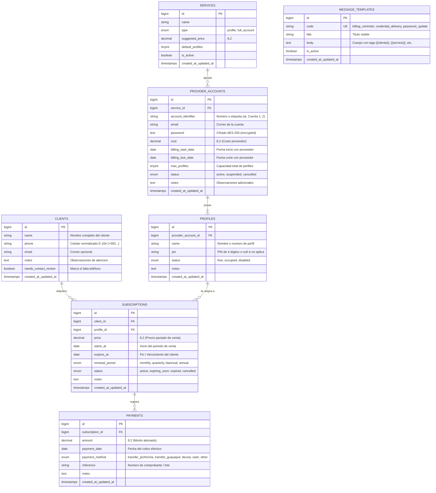

# Fase 2: Diseño de Base de Datos y Pantallas

**Proyecto:** TecnoStar — Sistema de Gestión de Cuentas y Suscripciones de Streaming  
**Autor:** Ingeniero de Software Senior  
**Estado:** Aprobado para Migraciones y Modelos (Fase 3)  
**Fecha:** Noviembre 2026  

---

## 1. Arquitectura de Datos y Principios de Diseño

El diseño de la base de datos se basa en el principio de normalización relacional (Tercera Forma Normal - 3NF), desacoplando las cuentas madre de los proveedores, los perfiles comercializables, los clientes, los contratos de venta (suscripciones) y las transacciones de pago.

### Principios Fundamentales:
1. **Tipado Estricto:** Monedas siempre en `decimal(8,2)`, fechas en `date`, y claves foráneas con integridad referencial explícita (`onDelete('cascade')` o `onDelete('restrict')`).
2. **Cifrado en Reposo:** Las contraseñas de las cuentas madre se almacenan en `provider_accounts.password` mediante una columna `text` tratada con el cast `encrypted` de Laravel (cifrado simétrico AES-256-CBC con la `APP_KEY`).
3. **Cálculo Financiero Dinámico:** No existen columnas estáticas de totales de ingresos, egresos ni ganancias. Se calculan en tiempo real mediante agregaciones `SUM()` sobre `payments` y `provider_accounts`.
4. **Optimización de Consultas:** Índices en campos de alta frecuencia en filtros operativos (`clients.phone`, `subscriptions.expires_at`, `subscriptions.status`, `provider_accounts.billing_due_date`).

---

## 2. Diagrama Entidad-Relación (DER)



---

## 3. Diccionario de Datos Detallado

### 3.1. Tabla: `services`
Representa el catálogo de plataformas (Netflix, Disney+, Spotify, Magis TV, etc.).
| Columna | Tipo | Nulo | Clave / Índice | Descripción |
| :--- | :--- | :--- | :--- | :--- |
| `id` | `BIGINT UNSIGNED` | NO | PK, AUTO_INCREMENT | Identificador único del servicio |
| `name` | `VARCHAR(100)` | NO | UNIQUE | Nombre comercial (ej. "Netflix", "Magis TV") |
| `type` | `ENUM('profile', 'full_account')` | NO | INDEX | Modalidad de venta (`profile` = pantallas, `full_account` = cuenta entera) |
| `suggested_price`| `DECIMAL(8,2)` | NO | | Precio de venta sugerido al público |
| `default_profiles`| `TINYINT UNSIGNED` | NO | | Perfiles típicos por cuenta (ej. 5 en Netflix, 1 en Spotify personal) |
| `is_active` | `BOOLEAN` | NO | INDEX | Estado habilitado para nuevas ventas (default: `true`) |
| `timestamps` | `TIMESTAMP` | SÍ | | Fechas `created_at` y `updated_at` |

---

### 3.2. Tabla: `provider_accounts`
Cuentas madre adquiridas con proveedores mayoristas.
| Columna | Tipo | Nulo | Clave / Índice | Descripción |
| :--- | :--- | :--- | :--- | :--- |
| `id` | `BIGINT UNSIGNED` | NO | PK, AUTO_INCREMENT | Identificador de la cuenta madre |
| `service_id` | `BIGINT UNSIGNED` | NO | FK -> `services.id` | Servicio al que pertenece |
| `account_identifier` | `VARCHAR(50)` | SÍ | | Identificador operacional (ej. "Cuenta 1", "Cuenta 2") |
| `email` | `VARCHAR(255)` | NO | INDEX | Correo electrónico de acceso con el proveedor |
| `password` | `TEXT` | NO | | Contraseña cifrada en reposo con AES-256 (`cast: encrypted`) |
| `cost` | `DECIMAL(8,2)` | NO | | Costo pagado al proveedor por la cuenta completa |
| `billing_start_date`| `DATE` | SÍ | | Fecha de inicio del ciclo con el proveedor |
| `billing_due_date` | `DATE` | NO | INDEX | Fecha de vencimiento / corte con el proveedor |
| `max_profiles` | `TINYINT UNSIGNED` | NO | | Cantidad máxima de perfiles configurados |
| `status` | `ENUM('active', 'suspended', 'cancelled')` | NO | INDEX | Estado operacional de la cuenta (default: `active`) |
| `notes` | `TEXT` | SÍ | | Notas internas del proveedor |
| `timestamps` | `TIMESTAMP` | SÍ | | Fechas `created_at` y `updated_at` |

---

### 3.3. Tabla: `profiles`
Unidad básica de inventario comercializable.
| Columna | Tipo | Nulo | Clave / Índice | Descripción |
| :--- | :--- | :--- | :--- | :--- |
| `id` | `BIGINT UNSIGNED` | NO | PK, AUTO_INCREMENT | Identificador del perfil |
| `provider_account_id` | `BIGINT UNSIGNED` | NO | FK -> `provider_accounts.id` (`onDelete cascade`) | Cuenta madre a la que pertenece |
| `name` | `VARCHAR(100)` | NO | | Nombre o etiqueta del perfil (ej. "Perfil 1", "Kids", "Principal") |
| `pin` | `VARCHAR(10)` | SÍ | | PIN numérico de acceso (ej. `8888`, o `null` si no usa) |
| `status` | `ENUM('free', 'occupied', 'disabled')` | NO | INDEX | Disponibilidad (`free` = listo para vender, `occupied` = vendido) |
| `notes` | `TEXT` | SÍ | | Observaciones |
| `timestamps` | `TIMESTAMP` | SÍ | | Fechas `created_at` y `updated_at` |

---

### 3.4. Tabla: `clients`
Directorio central de clientes.
| Columna | Tipo | Nulo | Clave / Índice | Descripción |
| :--- | :--- | :--- | :--- | :--- |
| `id` | `BIGINT UNSIGNED` | NO | PK, AUTO_INCREMENT | Identificador del cliente |
| `name` | `VARCHAR(150)` | NO | INDEX | Nombre del cliente |
| `phone` | `VARCHAR(25)` | SÍ | INDEX | Teléfono normalizado en formato internacional E.164 |
| `email` | `VARCHAR(255)` | SÍ | | Correo personal opcional |
| `notes` | `TEXT` | SÍ | | Historial o anotaciones de servicio |
| `needs_contact_review` | `BOOLEAN` | NO | INDEX | `true` si el teléfono es dudoso o está ausente (migración Excel) |
| `timestamps` | `TIMESTAMP` | SÍ | | Fechas `created_at` y `updated_at` |

---

### 3.5. Tabla: `subscriptions`
Contrato de venta entre un cliente y un perfil por un tiempo determinado.
| Columna | Tipo | Nulo | Clave / Índice | Descripción |
| :--- | :--- | :--- | :--- | :--- |
| `id` | `BIGINT UNSIGNED` | NO | PK, AUTO_INCREMENT | Identificador de la suscripción |
| `client_id` | `BIGINT UNSIGNED` | NO | FK -> `clients.id` (`onDelete restrict`) | Cliente comprador |
| `profile_id` | `BIGINT UNSIGNED` | NO | FK -> `profiles.id` (`onDelete restrict`) | Perfil o cuenta asignada |
| `price` | `DECIMAL(8,2)` | NO | | Precio pactado de la suscripción |
| `starts_at` | `DATE` | NO | | Fecha de inicio de vigencia para el cliente |
| `expires_at` | `DATE` | NO | INDEX | Fecha de vencimiento del servicio para el cliente |
| `renewal_period` | `ENUM('monthly', 'quarterly', 'biannual', 'annual')` | NO | | Periodicidad de cobro (default: `monthly`) |
| `status` | `ENUM('active', 'expiring_soon', 'expired', 'cancelled')` | NO | INDEX | Estado actual de la suscripción |
| `notes` | `TEXT` | SÍ | | Notas |
| `timestamps` | `TIMESTAMP` | SÍ | | Fechas `created_at` y `updated_at` |

---

### 3.6. Tabla: `payments`
Registro de ingresos monetarios reales asociados a una suscripción.
| Columna | Tipo | Nulo | Clave / Índice | Descripción |
| :--- | :--- | :--- | :--- | :--- |
| `id` | `BIGINT UNSIGNED` | NO | PK, AUTO_INCREMENT | Identificador del pago |
| `subscription_id` | `BIGINT UNSIGNED` | NO | FK -> `subscriptions.id` (`onDelete cascade`) | Suscripción que abona |
| `amount` | `DECIMAL(8,2)` | NO | | Monto cobrado |
| `payment_date` | `DATE` | NO | INDEX | Fecha efectiva del pago |
| `payment_method` | `ENUM(...)` | NO | | `transfer_pichincha`, `transfer_guayaquil`, `deuna`, `cash`, `other` |
| `reference` | `VARCHAR(100)` | SÍ | | Código de transferencia o comprobante |
| `notes` | `TEXT` | SÍ | | Notas |
| `timestamps` | `TIMESTAMP` | SÍ | | Fechas `created_at` y `updated_at` |

---

### 3.7. Tabla: `message_templates`
Plantillas dinámicas para la generación de enlaces de WhatsApp (`wa.me`).
| Columna | Tipo | Nulo | Clave / Índice | Descripción |
| :--- | :--- | :--- | :--- | :--- |
| `id` | `BIGINT UNSIGNED` | NO | PK, AUTO_INCREMENT | Identificador de la plantilla |
| `code` | `VARCHAR(50)` | NO | UNIQUE | Código de uso (`billing_reminder`, `credential_delivery`, `password_update`) |
| `title` | `VARCHAR(100)` | NO | | Nombre legible para la interfaz |
| `body` | `TEXT` | NO | | Texto con variables `{{client_name}}`, `{{service_name}}`, `{{pin}}`, etc. |
| `is_active` | `BOOLEAN` | NO | | Si está habilitada |
| `timestamps` | `TIMESTAMP` | SÍ | | Fechas `created_at` y `updated_at` |

---

## 4. Fórmulas Financieras Dinámicas

El cálculo de ingresos, egresos y ganancias no reside en columnas fijas. Se implementa en `app/Services/FinancialReportService.php`:

```sql
-- 1. Total Ingresos del Mes:
SELECT COALESCE(SUM(amount), 0) AS total_income 
FROM payments 
WHERE payment_date BETWEEN :start_date AND :end_date;

-- 2. Total Egresos del Mes (Cuentas proveedor vigentes):
SELECT COALESCE(SUM(cost), 0) AS total_expense 
FROM provider_accounts 
WHERE status != 'cancelled' 
  AND billing_due_date BETWEEN :start_date AND :end_date;

-- 3. Ganancia Neta:
Ganancia = total_income - total_expense;

-- 4. Margen de Ganancia:
Margen (%) = (Ganancia / total_income) * 100;
```

---

## 5. Diseño de Pantallas (Vistas Blade)

La interfaz se estructura con plantillas Blade puras, HTML5 semántico y CSS moderno, diseñada para una experiencia ágil de un solo operador en escritorio y móvil.

### 5.1. Layout Base (`resources/views/layouts/app.blade.php`)
- **Barra lateral (Sidebar):**
  - Logotipo de TecnoStar y estado del sistema.
  - Enlaces de navegación: **Dashboard**, **Tablero de Vencimientos** (con badge de cantidad que vencen hoy), **Inventario de Cuentas y Perfiles**, **Clientes**, **Suscripciones**, **Reportes Financieros** y **Plantillas WhatsApp**.
- **Barra superior (Navbar):**
  - Fecha actual (`America/Guayaquil`).
  - Alerta rápida de cuentas madre próximas a vencer.
  - Perfil de usuario y botón de cerrar sesión.

---

### 5.2. Wireframes de Pantallas Principales

#### Pantalla 1: Dashboard General (`/dashboard`)
```
+------------------------------------------------------------------------------------+
|  TECNOSTAR   |  Dashboard  |  Vencimientos (5)  |  Cuentas  |  Clientes  |  Reportes   |
+------------------------------------------------------------------------------------+
|                                                                                    |
|  [ INGRESO MES ]        [ EGRESO MES ]        [ GANANCIA NETA ]      [ PERFILES ]   |
|     $ 340.50               $ 112.00               $ 228.50            14 Libres    |
|   +12% vs anterior       Cuentas mayorista       Margen: 67.1%        26 Ocupados  |
|                                                                                    |
|  +--------------------------------------------+  +-------------------------------+  |
|  | RESUMEN DE VENCIMIENTOS DE HOY             |  | STOCK POR SERVICIO            |  |
|  | ------------------------------------------ |  | Netflix:    [====  ] 4/5 lib. |  |
|  | - Edison (Netflix Perfil 1) -> Vence HOY   |  | Disney+:    [======] 6/7 lib. |  |
|  |   [💰 Cobrar]  [🔐 Clave]                  |  | Spotify:    [==    ] 2 disp.  |  |
|  | - Vaneza (Disney Perfil 2)  -> Vence HOY   |  | Magis TV:   [=======] 8 disp. |  |
|  |   [💰 Cobrar]  [🔐 Clave]                  |  +-------------------------------+  |
|  +--------------------------------------------+                                    |
+------------------------------------------------------------------------------------+
```

#### Pantalla 2: Tablero Operativo de Vencimientos (`/expirations`)
El centro de mando diario del negocio, reemplazando las fórmulas del Excel:
```
+------------------------------------------------------------------------------------+
|  TABLERO DE VENCIMIENTOS Y ACCIONES DE COBRO                                       |
+------------------------------------------------------------------------------------+
|  [ (5) Vencen Hoy ]   [ (12) Vencen en 1-3 días ]   [ (8) Vencidos ]   [ Proveedor]|
+------------------------------------------------------------------------------------+
| Cliente           | Servicio | Perfil  | PIN  | Vence      | Días | Acciones Ráp.  |
|-------------------+----------+---------+------+------------+------+----------------|
| Cliente Jhonatan  | Netflix  | Jhonatan| 8888 | 2026-11-11 |  0   | [💰] [🔐] [💻] |
| Vaneza Ponce      | Disney+  | Vaneza  | 4444 | 2026-11-11 |  0   | [💰] [🔐] [💻] |
| Danny U           | Max      | Kevin   | 5555 | 2026-11-12 |  1   | [💰] [🔐] [💻] |
| Carlos Veloz      | Netflix  | Erika   | 2025 | 2026-11-13 |  2   | [💰] [🔐] [💻] |
+------------------------------------------------------------------------------------+
* Al hacer clic en [💰]: abre wa.me/593XXXXXXXX?text=Hola+Jhonatan,+te+recordamos...
* Al hacer clic en [🔐]: abre wa.me/593XXXXXXXX?text=Hola+Jhonatan,+tu+nueva+clave...
* Al hacer clic en [💻]: abre wa.me/593XXXXXXXX?text=Datos+de+acceso:+Netflix+Perfil...
```

#### Pantalla 3: Inventario de Cuentas Madre y Perfiles (`/provider-accounts`)
```
+------------------------------------------------------------------------------------+
|  INVENTARIO DE CUENTAS MADRE                                 [ + Nueva Cuenta ]    |
+------------------------------------------------------------------------------------+
|  NETFLIX #1 - starstreaming593@gmail.com                     Costo: $12.00 / mes   |
|  Corte Proveedor: 2026-12-01 (en 20 días)                    Estado: [ ACTIVA ]    |
|  --------------------------------------------------------------------------------  |
|  Perfiles (4/5 ocupados):                                                          |
|  - Perfil 1: [Jhonatan] (PIN: 8888) -> Ocupado por Cliente Jhonatan ($4.00/mes)    |
|  - Perfil 2: [Joanna]   (PIN: 1248) -> Ocupado por Cliente Joanna   ($2.50/mes)    |
|  - Perfil 3: [Mireya]   (PIN: 4444) -> Ocupado por Mireya Farinango ($4.00/mes)    |
|  - Perfil 4: [Madeline] (PIN: 5555) -> Ocupado por Madelene         ($4.00/mes)    |
|  - Perfil 5: [Libre]    (PIN: ----) -> [ + Vender Perfil ]                         |
+------------------------------------------------------------------------------------+
```

---

## 6. Mapeo a la Arquitectura Laravel

| Componente | Clases y Archivos | Responsabilidad |
| :--- | :--- | :--- |
| **Modelos** | `app/Models/{Service, ProviderAccount, Profile, Client, Subscription, Payment, MessageTemplate}.php` | Definición de relaciones Eloquent, scopes de consulta y casts (`encrypted`, `decimal:2`, `date`). |
| **Controladores** | `app/Http/Controllers/{DashboardController, ProviderAccountController, ProfileController, ClientController, SubscriptionController, PaymentController, ExpirationController}.php` | Controladores delgados que orquestan solicitudes HTTP y retornan vistas Blade. |
| **Form Requests** | `app/Http/Requests/{StoreProviderAccountRequest, StoreClientRequest, StoreSubscriptionRequest, StorePaymentRequest}.php` | Validación estricta de formularios y tipos de datos. |
| **Servicios** | `app/Services/FinancialReportService.php` | Cálculo en tiempo real de ingresos, egresos y márgenes. |
| **Servicios** | `app/Services/WhatsAppMessageService.php` | Construcción de URLs codificadas para `wa.me` a partir de plantillas dinámicas. |
| **Servicios** | `app/Services/ExcelImportService.php` | Ingestión, limpieza de datos y reporte de discrepancias (Fase 5). |
| **Vistas Blade** | `resources/views/{layouts, dashboard, expirations, accounts, clients, subscriptions, payments}` | Plantillas HTML5 responsivas con componentes reutilizables. |

---

## 7. Criterios de Aceptación de la Fase 2
- [x] Diagrama Entidad-Relación formalizado con Mermaid.
- [x] Diccionario de datos completo con tipos de datos para MySQL y directivas de clave foránea.
- [x] Fórmulas matemáticas dinámicas definidas para el módulo financiero.
- [x] Wireframes y experiencia de usuario diseñados para el tablero operativo de cobro.
- [x] Mapeo de archivos y responsabilidades de código Laravel aprobado para la Fase 3.
